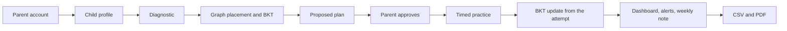

# Beacon Math

Parent-controlled mastery practice for elementary math. This is a local MVP for a homeschool pilot (grades 2–4, early 2027): a parent account, child profiles, a short adaptive diagnostic, daily practice on frontier skills, deterministic mastery, and a record the parent can export.

Beacon does not show model-written text to children, does not offer chat, and does not call a third-party analytics service.

## Stack

- Next.js (App Router) and TypeScript
- Prisma with SQLite for local development (`DATABASE_URL` can later point at Postgres; the schema uses Prisma types that move over, with a provider change)
- Auth is an httpOnly JWT cookie. Passwords are hashed with bcrypt.
- Mastery, item selection, the diagnostic, and the weekly note are plain TypeScript. Vitest covers them without the database.

## How to run

```bash
npm install
cp .env.example .env
npx prisma db push
npm run db:seed
npm test
npm run dev
```

Open [http://localhost:3000](http://localhost:3000).

Seeded local accounts (change these before any shared deploy):

| Who | Email | Password |
| --- | --- | --- |
| Parent | parent@example.com | homeschool-demo |
| Admin | admin@example.com | admin-demo-change |

The parent household already has:

- **Sam**, grade 2, with no attempts. Use Sam to walk the new-child path: diagnostic, approve the plan, practice.
- **Riley**, grade 3, with a week of practice, an approved plan, a stall alert, a ready alert, and a weekly note.

You can also register a new parent. Children are stored as a nickname and a grade only.

## Walk the product

1. Sign in as the parent and open a child.
2. **Start diagnostic.** The browser enters child mode. The parent password is required to leave it. About ten questions, one per skill, following the prerequisite graph.
3. Unlock. The dashboard shows placed skills, confidence, and a proposed plan. Practice stays locked until you approve it.
4. Change the plan if you want, then **Approve plan**.
5. **Start practice.** Items come from the approved frontier, with spaced review mixed in when a mastered skill is due. Wrong answers name the mix-up in pre-written language.
6. Unlock again. Confidence and status on the map have moved.
7. Open the weekly note, the printable record, or download CSV / PDF.

Sessions stop when the timer ends (12 minutes for a diagnostic, 10 / 15 / 20 for practice) or when the child taps **Finish for today**.

## Architecture



Skill definitions and parametric item templates live in `src/content`. Attempts, per-child mastery, plans, and alerts live in SQLite.

A skill is on the **frontier** when every prerequisite is mastered and the skill itself is not. Practice rotates through the frontier skills on the approved plan. About one item in three is a due review. Review spacing is 1, 3, 7, 16, then 35 days.

**Mastery** is Bayesian Knowledge Tracing (`src/lib/bkt.ts`):

- prior 0.15, learn 0.12, guess 0.25, slip 0.10
- mastered at probability ≥ 0.95 and at least 5 attempts
- a single correct diagnostic item does not master that skill
- passing a skill places its unattempted prerequisites as mastered and labels them "Placed by diagnostic", unless that prerequisite was actually missed

Item templates carry a difficulty that moves with a small Elo-style update after practice (`src/lib/elo.ts`). Selection prefers a template near the child's current mastery. That adjustment is secondary to BKT.

The weekly note is filled from logged attempts (`src/lib/report.ts`). It is not generated by a language model.

Roles:

- **Parent** — household, plans, reports, export, deletion
- **Child session** — the current diagnostic or practice only. Parent routes are refused until the parent password is entered again.
- **Admin** — counts and household nicknames. Admins do not start practice or export a child's record.

Deleting a child removes the profile and every attempt, plan, session, and alert attached to it.

## Tests

```bash
npm test
npm run typecheck
```

With the app already running, `node scripts/smoke.mjs` registers a parent, runs a diagnostic, approves a plan, practices, and checks the report, CSV, and PDF.

Tests cover BKT updates and the mastery threshold, frontier and review selection, diagnostic movement and placement, plan checks, stall detection, weekly-note text, item validity (one correct answer, tagged distractors, the math checked independently of the stem), and a smoke check that the PDF export is a PDF.

## What's next

- Replace SQLite with Postgres and add a real migration history before the pilot.
- Email verification, password reset, and a session inventory for the parent.
- Widen the map past this grade 2–4 slice (operations, base ten, fractions, a little measurement).
- Calibrate item difficulty on real attempts; the Elo update here is only a start.
- A fuller adaptive diagnostic (two items on borderline skills, stop when the frontier is stable).
- Parent-configurable review load, and a way to send a stalled skill back to its prerequisite from the alert.
- Content review by a teacher for every explanation before children see it.
- Production headers, backup, and a deletion log. This MVP stores the deletion by removing the rows.
- Accessibility pass with a screen reader on the child player, and optional read-aloud that uses the same pre-written strings.
